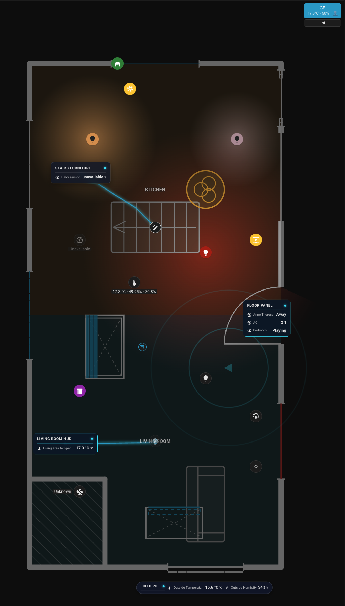
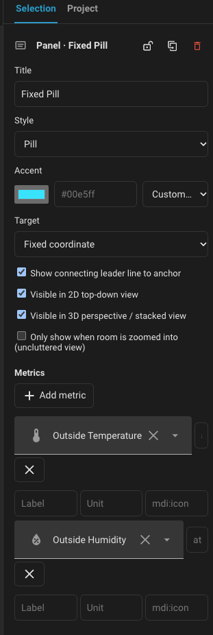

# Floor Summaries & Telemetry Info-Panels

Floor summaries and telemetry callout info-panels ([GitHub Issue #234](https://github.com/nicosandller/easy-floorplan/issues/234)) bring spatial aggregate climate, occupancy, energy, and device metrics into `easy-floorplan` without cluttering your floorplan layout.

This feature provides two complementary presentation layers:
1. **Floor Switcher Aggregate Summaries**: Multi-metric summaries embedded directly on the floor switcher buttons, displaying climate, presence, active lights, and open windows for every floor at a glance.
2. **Spatial Telemetry Info-Panels (Callout HUD Cards)**: Floating callout cards with angled SVG leader lines anchored to rooms, furniture, appliances, or roofs in both 2D and 3D views.

---

## 1. Floor Switcher Aggregate Summaries

The floor switcher lets you monitor the status of all floors simultaneously without clicking between them.

```yaml
type: custom:easy-floorplan-card
floorSummary:
  enabled: true
  decimals: 1
  metrics:
    - temperature
    - humidity
    - presence
    - lights
    - windows
floors:
  - id: ground
    name: Ground Floor
    summary:
      enabled: true
      temperatureEntity: sensor.ground_floor_mean_temp # optional helper override
      humidityEntity: sensor.ground_floor_humidity     # optional helper override
      presenceEntity: binary_sensor.ground_presence    # optional helper override
```

### Automatic Sensor Discovery
If you don't configure explicit helper entities, the card automatically discovers candidate sensors on each floor:
- **Room / Area linkage**: Scans all rooms on the floor linked to Home Assistant areas (`area.haArea`) or entity trackers.
- **Floor-level linkage**: Scans Home Assistant areas belonging to the floor's Home Assistant Floor (`floor.haFloor`).
- **Averaging & Unit Conversion**: Aggregates all temperature and humidity sensors on the floor, automatically reconciling mixed units (°C and °F) and rounding to your configured `decimals`.
- **Active State Tally**: Counts occupied rooms / detected persons (`👤 N`), lights currently on (`💡 N`), and open windows or doors (`🪟 N`).

### Visual Editor Integration
1. Click the floor settings button (the floor name dropdown or pencil/cog icon) in the editor header.
2. Toggle **Summary enabled** with a single click.
3. When enabled, optional helper entity pickers (**Temp helper**, **Humidity helper**, **Presence helper**) expand immediately if you prefer to use dedicated Home Assistant Min/Max helpers. When disabled, the helpers remain hidden and summary computations for that floor are omitted.

---

## 2. Spatial Telemetry Info-Panels

Info-panels are floating HUD cards linked by an orthogonal or angled SVG leader line to a specific point on your plan.



```yaml
floors:
  - id: 1st
    name: First Floor
    panels:
      # Compact appliance / workstation monitor
      - id: workstation_panel
        targetType: furniture
        targetId: desk_pc
        style: slim
        x: 680
        'y': 220
        title: Workstation
        tag: OFFICE
        status: ACTIVE
        metrics:
          - entity: sensor.workstation_power
            label: Power Draw
            icon: mdi:flash
            unit: "W"
          - entity: sensor.workstation_temp
            label: CPU Temp
            icon: mdi:thermometer
            unit: "°C"
        tap_action:
          action: more-info
          entity: switch.workstation_outlet

      # Extended room climate & environmental monitor
      - id: living_room_panel
        targetType: area
        targetId: living_room
        style: extended
        x: 180
        'y': 140
        title: Living Room
        tag: CLIMATE
        status: OK
        metrics:
          - entity: sensor.living_room_temp
            label: Temperature
            icon: mdi:thermometer
            unit: "°C"
          - entity: sensor.living_room_humidity
            label: Humidity
            icon: mdi:water-percent
            unit: "%"
          - entity: sensor.living_room_co2
            label: Air Quality
            icon: mdi:molecule-co2
            unit: "ppm"
        tap_action:
          action: zoom
```

### Anchor Targets (`targetType`)
Each panel connects to a spatial anchor via an SVG leader line:
| `targetType` | Description | Leader Line Behavior |
| --- | --- | --- |
| `area` | Anchors to a room boundary or room center. | Automatically tracks room center; clicking panel can zoom into room. |
| `furniture` | Anchors to furniture or appliances (desk, server rack, TV, 3D printer). | Follows the furniture item if moved. |
| `floor` | Anchors to general floor coordinates. | General level telemetry. |
| `roof` | Anchors to a roof outline. | Supports full 3D outdoor elevation projection! |
| `custom` | Anchors to explicit `anchorX` and `anchorY` canvas coordinates. | Fixed pin anywhere on canvas. |

### 3D Projection & Outdoor Roof Attachment
In 3D view (`view: 3d`) and outdoor stacked house view (`isOutdoor: true`):
- Panels attached to floors or rooms project at their floor's physical elevation.
- Panels attached to roofs (`targetType: roof`) project at the roof's physical 3D elevation (`z0 = floorBaseZ + wallHeight`), enabling exterior rooftop telemetry (e.g. solar PV generation, roof weather stations, ambient exterior temperatures).
- Leader lines render dynamically in 3D isometric space connecting the panel to the 3D surface point.

### Visual Styles
- **`slim`**: Streamlined single-column HUD card with title bar, tag, status pill, and stacked icon/label/value rows. Ideal for desks, appliances, equipment, and tight layouts.
- **`extended`**: Wide card with high-visibility primary readings, secondary status indicators, and contextual sub-labels.

### Interactive Tap Actions
Panels support full Lovelace tap actions:
- `zoom`: Instantly zooms and centers the floorplan on the anchored room or element.
- `navigate`: Navigates to another dashboard path or subview.
- `more-info`: Opens Home Assistant's native entity more-info dialog for a linked entity.
- `url`: Opens an external link.
- `none`: Disables tap interaction.

### Visual Editor Support
- **Add**: Choose **+ Add → Panel** to drop a new callout panel onto the active floor.
- **Position**: Drag the panel card to position it on the canvas. Drag the target crosshairs to place or snap the anchor onto any room, furniture piece, or roof.
- **Inspector**: Select the panel to configure its title, tag, style (`slim` vs `extended`), target type, metrics list, and tap action in the sidebar inspector.


